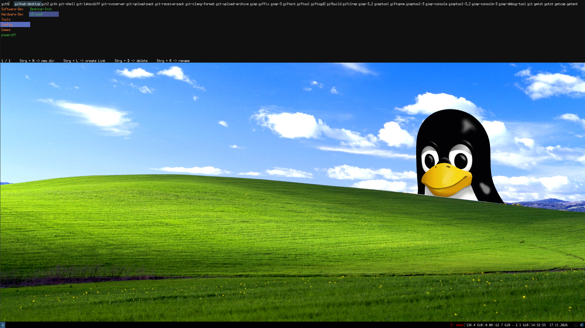

# runmenu

A more capable, two-dimensional alternative to `dmenu` for X11.



runmenu is a lightweight application launcher that fits nicely into tiling setups like **i3-wm**. Where `dmenu` gives you a single search line over everything in your `PATH`, runmenu gives you a menu you can actually *navigate*: a folder structure of quick selects that you control, with `PATH` search running right alongside it.

## Features

- **Two interfaces in one** – a browsable folder menu and a search bar, both active at the same time. You never have to choose between them.
- **Navigable quick selects** – browse a folder structure of your own favorites instead of a flat list of everything installed.
- **Simultaneous `PATH` search** – anything in your `PATH` is searched at the same time as your quick selects.
- **Configured with a plain directory** – no config language, just files and folders.
- **Hidden file extensions** – make a shell script show up like a normal executable (`backup.sh` appears as `backup`).
- **Symlink support** – link to any program or script and it shows up in the menu.
- **Custom sort order** – prefix entries with `%1%`, `%2%`, ... to order them; the prefix is never displayed.
- **Manage your config with hotkeys** – add, rename, and delete entries from inside runmenu, no need to touch the terminal.
- **Lightweight** – small C program, no package manager required.

## Requirements

- X11 (Wayland is not supported)
- A C compiler and `make`

## Installation

```sh
git clone https://github.com/MrQbasic/runmenu.git
cd runmenu
make
sudo make install
```

`make install` simply copies the executable to `/usr/bin`. There is no distro package.

## Usage

Run `runmenu` directly, or bind it to a key. With i3, add this to `~/.config/i3/config`:

```
bindsym $mod+d exec --no-startup-id runmenu
```

### How it works

runmenu is "2D": it combines two functions in a single interface, and you don't need to switch modes to use either one.

1. **The folder browser** shows your quick selects (the contents of `~/.config/runmenu/`) and lets you move through them like a file manager.
2. **The search bar** searches your quick selects and everything in your `PATH` at the same time.

### Keys

| Key | Action |
| --- | --- |
| `↑` / `↓` | Browse through the current folder |
| `→` | Enter the selected folder, or execute the selected entry |
| `←` | Go back to the parent folder |
| *any text* | Typed straight into the search bar |
| `Enter` | Execute the current search |
| `Tab` | Switch between the search suggestions |
| `Esc` | Close runmenu |
| `Ctrl` + `N` | New directory |
| `Ctrl` + `R` | Rename the current directory or file |
| `Ctrl` + `L` | Add the selected file from the search results to the current folder |
| `Ctrl` + `D` | Delete the current directory or file |

## Configuration

Everything lives in a normal directory:

```
~/.config/runmenu/
```

Whatever is in there shows up in the quick select menu.

- **Files** become launchable entries.
- **Folders** become submenus you can navigate into.
- **File extensions are hidden**, so a script named `screenshot.sh` is displayed as `screenshot`.
- **Symlinks work**, so you can point entries at programs elsewhere on your system.

### Sorting entries

To control the order of entries, add a numeric prefix in the form `%N%` to the file or folder name. Entries are sorted in rising order, smallest number first. The prefix is used only for sorting and is not displayed in the menu.

| Name on disk | Shown as |
| --- | --- |
| `%1%browser` | `browser` |
| `%2%terminal` | `terminal` |
| `%20%tools` | `tools` |

This works for folders as well as files, so you can order submenus the same way.

### Example layout

```
~/.config/runmenu/
├── %1%browser            -> /usr/bin/firefox   (symlink, shown as "browser")
├── %2%terminal           -> /usr/bin/alacritty (symlink, shown as "terminal")
├── %3%media/             (shown as "media")
│   └── music             -> /usr/bin/spotify
└── %20%tools/            (shown as "tools")
    ├── %1%backup.sh      (shown as "backup")
    └── %2%screenshot.sh  (shown as "screenshot")
```

## License

GPL-3.0, see [LICENSE](LICENSE).
